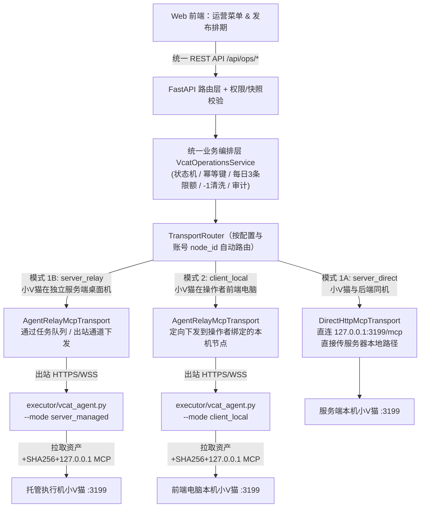

# 获客空间接入小V猫：可行性、MCP 实测映射与双模式详细设计

评估与实测日期：2026-11-26（北京时间）｜状态：已完成真实 MCP 实测、双模式架构设计与首期落地｜目标版本：小V猫桌面端 `3.1.0`（MCP 协议 `2025-03-26`）。

## 1. 结论与架构重点

**核心能力已通过真实会员态 MCP 实测验证；支持“服务器联通模式”与“Web 前端 + 本机小V猫模式”共用同一套业务接口与编排逻辑，仅在最终传输层分流。**

1. **真实 MCP 已打通**：本机实测 `http://127.0.0.1:3199/mcp`（Streamable HTTP + `Mcp-Session-Id` + Bearer Token）已成功握手，共发现 **119 个官方 MCP 工具**（49 只读 / 70 写入）。已完成抖音、小红书、视频号三平台测试账号实测：Web `iframe` 无感上号、三平台推送草稿箱、统计实时刷新、作品与指标同步、视频号账号诊断与扫脸验证链接均已验证通过。
2. **关键边界已实锤**：
   - **公众号**：实测 `vcat_get_publish_options("公众号")` 返回 **`"平台 GongZhongHao 暂不支持 MCP 发布"`**，`vcat_create_draft` / `vcat_create_publish_task` 亦不支持公众号。按已确认首期口径（公众号仅推送到草稿箱，由人工后台群发），公众号须走**独立微信官方草稿箱 API（或人工登记兜底）**，不依赖小V猫 MCP。
   - **每日验证链接**：`vcat_get_verify_links` 实锤**仅支持视频号**（对抖音/小红书调用报错 `"账号 ... 不是视频号账号"`）；视频号可通过云端验证链接在 Web 展示二维码完成手机验证。
   - **浏览器直接直连小V猫不可行**：实测小V猫 `OPTIONS` 预检返回 `401` 且无 CORS 响应头，同时发布参数 `videoPath`/`cover` 强制要求小V猫所在机器的本机绝对路径，且 MCP Token 不得暴露给浏览器。因此「Web 前端 + 本机小V猫模式」必须由操作者电脑运行同一份轻量本机代理 `executor/vcat_agent.py --mode client_local` 承接，保持**一套后端 API、一套业务编排、两类节点模式仅在传输层切换**。
3. **导航与兼容边界**：保留原有「内容生产 → 发布排期」不动（历史手工排期默认 `execution_mode=manual`），新增**「运营」主菜单**集中承载账号与授权、授权中心、发布任务、作品与数据、评论与私信、监控与告警（及后续 P3 店铺与订单）；「系统设置 → 发布执行器」升级为双模式配置与节点状态中心。

| 需求项 | 实测结论 | 成立条件与差距 |
|---|---|---|
| 抖音/小红书/视频号/B站按排期调用小V猫发布 | **可行（草稿链路已实测）** | 抖音/小红书/视频号草稿箱写入与回读已通过；B站字段已从 `vcat_get_publish_options` 核实，待实测账号试写；公开试发待授权 |
| 公众号首期推送到草稿箱 | **小V猫 MCP 不支持，改走微信通道** | 已实锤 `GongZhongHao` 不支持 MCP 发布；改为复用已有公众号 `app_id`/`app_secret` 调微信草稿箱 API 或人工登记，状态标 `DRAFT_PUSHED` |
| Web 端无感接入新账号（抖音/小红书） | **已通过实测** | `vcat_create_login_link` + `vcat_list_login_links` 返回无品牌「登录助手」网页，实测可用 `iframe` 内嵌完成扫码入库，自动取得稳定 `uid`（自动化代点会触发 `BOT_CHECK`，必须由用户浏览器交互） |
| 每日扫码 / 掉线重登 / 视频号二次验证 | **视频号已通过，其余平台有缺口** | 视频号 `vcat_verify_account` + `vcat_get_verify_links` 已实测生成云端验证链接；抖音/小红书/B站无针对已有失效 `uid` 定向刷新二维码的 MCP 工具，掉线重登覆盖语义待测；小V猫自身退出登录仍需在所在机器恢复 |
| 服务器联通 vs Web 前端 + 本机小V猫双模式 | **架构可行且可共用一套代码** | 业务层统一调用 `McpExecutionTransport`；服务器端模式走直连或托管执行机，前端本机模式复用同款轻量代理出站注册与本机执行，不维护两套业务接口 |
| 作品、数据、评论、私信、监控迁移 | **大部分已满足，建监控任务有缺口** | 作品/统计/评论/私信读写工具齐全（需清洗小红书 `-1` 缺失值）；MCP 仅支持查询/启停/运行已有内容监控任务，未开放创建通用内容监控任务的工具，由服务器定时同步+规则计算生成告警 |

---

## 2. 已确认需求与产品口径

| 项目 | 已确认约束 |
|---|---|
| 平台范围 | 第一期：抖音、小红书、视频号、B站、公众号 |
| 公众号口径 | **首期仅支持推送到草稿箱并明确标记为草稿态（`DRAFT_PUSHED`），由人工在公众号后台群发；不冒充已公开发表** |
| 导航结构 | **保留「内容生产 → 发布排期」不动**；新增独立**「运营」主菜单**承载账号授权、授权中心、发布任务、作品数据、评论私信、监控告警等模块 |
| 发布频率上限 | 每账号每天不超过 3 条（按 `Asia/Shanghai` 自然日计数）；总账号数 `A` 按实际绑定动态扩展 |
| 部署配置模式 | 支持 **模式一：服务器联通模式**（随时随地 Web 端全功能操作）与 **模式二：Web 前端 + 本机小V猫模式**（小V猫装在操作者电脑），且允许混合绑定不同账号 |
| 用户交互边界 | Web 端全程对普通用户屏蔽小V猫界面（不提供远程桌面）；扫码通过 Web `iframe` 内嵌「登录助手」或展示云端验证二维码，由用户手机 App 确认 |
| 排期与时区 | 获客空间为排期、审批与资产哈希唯一权威源；内部统一 UTC ISO-8601 存储，Web 固定按 `Asia/Shanghai` 输入和展示；小V猫 MCP 定时参数自动转换为 `YYYY-MM-DD HH:mm` 本机时间 |

---

## 3. 2026-11-26 真实 MCP 实测取证与上游缺陷

### 3.1 项目与协议实测基线

1. **项目基线**：工作区 `acquisition-space`，后端 FastAPI + SQLAlchemy + SQLite WAL（`backend/app/main.py`、`backend/app/db.py`、`backend/app/worker.py`），前端 React + Vite（`frontend/src/App.tsx`、`frontend/src/pages/Schedules.tsx`、`frontend/src/pages/SettingsPage.tsx`）。
2. **小V猫 MCP 运行态协议实测**：
   - 监听地址：`http://127.0.0.1:3199/mcp`，仅绑定回环地址，必须登录会员态且手动开启。
   - 传输格式：**Streamable HTTP**（`POST` 请求携带 `Authorization: Bearer <token>`、`Content-Type: application/json`、`Accept: application/json, text/event-stream`；服务端返回 `Content-Type: text/event-stream` 与 `Mcp-Session-Id` 响应头，后续调用需透传该会话头）。
   - 工具清单：`tools/list` 一次返回全部 **119 个工具**（**49 只读** `readOnlyHint=true` + **70 写入** `destructiveHint=true`），未勾选写模块时 Schema 依然可见，调用写工具前需在小V猫开启对应模块。
   - CORS 预检实测：`OPTIONS http://127.0.0.1:3199/mcp`（带 `Origin: http://localhost:5173`）返回 **`401 Unauthorized`** 且没有任何 `Access-Control-Allow-*` 响应头，实锤**浏览器前端 JS 无法跨域直连 `127.0.0.1:3199/mcp`**。

### 3.2 三平台测试账号全链路实测结果（0 条真实发布）

实测授权账号（已脱敏）：**抖音** `<douyin_test_uid>`（「测试号A」）、**小红书** `<xhs_test_uid>`（「测试号A」）、**视频号** `<channels_test_uid>`（「测试号B」）。

| 验证项 | 实测结果 | 关键观察与数据结构证据 |
|---|---|---|
| 纯 Web `iframe` 上号 | **通过** | `vcat_create_login_link` + `vcat_list_login_links` 返回 `https://mp.c1ink.cn/xvcat/eternal-login/<CODE>`；页面仅显示“登录助手 / 登录账号 / 获取登录二维码”，无小V猫/宝特品牌且无 `X-Frame-Options` 拦截。用户在 `iframe` 扫码后，抖音与小红书新号立即入库且 `loginStatus="登录有效"`、返回稳定 `uid`。注意：用自动化无头浏览器代点按钮会触发 `BOT_CHECK`，必须由真实用户浏览器交互完成。 |
| 三平台草稿箱写入与回读 | **全部通过** | 分别调用 `vcat_create_draft` 成功写入并经 `vcat_list_drafts` 回读 `draftId=1`（抖音，`visibility_type=1`）、`draftId=2`（小红书，`privacy_type=1`）、`draftId=3`（视频号，`scheduleType="timing"`、`CAT_shortTitle`、`postFlag=0`）。详情接口返回完整 `platformOptionsByUid`、`videoPath`、`CAT_cover`（自动规范为 `file://`），且定时时间由北京时间 `YYYY-MM-DD HH:mm` 自动转为 UTC ISO（`CAT_timing.time`）。 |
| 账号统计刷新与分日回读 | **全部通过** | `vcat_refresh_account_stats` 成功刷新 3 个测试账号：抖音粉丝由 `null → 3`（0 作品）；小红书由 `null → 13`（42 赞、42 藏、15 作品及近 7 日分日序列）；视频号粉丝 `2`、近 7 日播放 `37`。 |
| 作品同步与单作品明细 | **全部通过** | `vcat_start_post_sync` 约 28 秒同步完成 11 条作品（视频号 1、小红书 10、抖音 0）。`vcat_list_posts` / `vcat_get_post` 成功返回稳定 `postId`、作品链接 `url`、播放/点赞/评论/转发/涨粉、完播率 `fullView` 与均播时长 `viewTime`。 |
| 视频号诊断与扫脸验证 | **通过（边界实锤）** | `vcat_verify_account` 返回 `videoStatus`（含 `isAdmin: true` 及平台建议）、`liveStatus`、`heatStatus`、`faceStatus: "无验证"`、`abnormalPostCount: 0`；`vcat_get_verify_links` 返回云端链接 `https://mp.c1ink.cn/xvcat/verify-helper/<ID>`。对抖音/小红书调用 `vcat_get_verify_links` 返回错误 `"账号 ... 不是视频号账号"`。 |
| 公众号发布能力探测 | **确认不支持** | `vcat_get_publish_options(platform="公众号")` 返回 `"平台 GongZhongHao 暂不支持 MCP 发布"`；`vcat_create_draft` / `vcat_create_publish_task` 支持列表仅含 `抖音、哔哩哔哩、快手、视频号、小红书、西瓜、头条号、百家号`。 |

### 3.3 实测发现的 4 个上游坑与项目规避策略

| 编号 | 实测现象 | 影响 | 项目规避方案 |
|---|---|---|---|
| B1 | `vcat_create_login_link` 仅返回 `{"success": true}`，不返回新建的 `id` 与 `url` | 无法直接从创建响应拿到上号链接 | 统一封装为“创建后立即调用 `vcat_list_login_links` 按 `platform`/`groupId`/最新 `createTime` 匹配取回 `id` 与 `url`”的原子动作 |
| B2 | `vcat_start_post_sync(limit=5)` 对小红书仍按整页拉回 10 条，且小红书缺失指标返回 `-1`（如 `show: -1`、`fansAdd: -1`、`viewTime: -1`） | 直接入库会把 `-1` 当成负增长或污染平均时长 | 入库按 `(platform, uid, postId)` 幂等 upsert；同步适配器统一将数值型字段中的 `< 0` 哨兵值（`-1`）清洗为 `null` |
| B3 | `vcat_set_account_group` 传 `groupId: 0` 报错 `"group_id/account_ids不能为空"`（与 Schema 描述不符） | 无法用 `0` 移回默认分组 | 需要移出分组时改传 `groupId: null`（或先测试 `null` 行为），并把分组权威映射保存在获客空间数据库 |
| B4 | `vcat_delete_tag` 在账号解绑（`accountCount=0`）后仍报错 `"Cannot read properties of undefined (reading 'includes')"` | 无法通过 MCP 清理标签 | 团队/IP/运营标签完全在获客空间数据库维护，不依赖 `vcat_delete_tag`；仅按需向小V猫单向同步分组/备注 |

---

## 4. 全量业务操作 ↔ 小V猫 MCP 工具精确映射

> 所有以下操作均先进入项目后端 `VcatOperationsService`，通过统一指令 `VcatActionCommand` 经传输层路由到小V猫 MCP；表中标明所需的最小小V猫 MCP 写权限模块（如 `manage`、`publish`、`stats`、`post`、`verify`、`comment`、`message`、`monitor`、`shop`）。

### 4.1 账号与授权（运营 → 账号与授权）

| 业务操作 | 具体 MCP 工具 | 读/写与模块 | 关键入参 / 出参与适配要点 | 实测状态 |
|---|---|---|---|---|
| 同步/查询账号列表与登录状态 | `vcat_list_accounts` | 只读 | 入参 `platform/groupName/keyword/loginStatus/page/pageSize`；返回 `uid, platform, platformName, nickname, avatar, groupName, tags, loginStatus, fansTotal` | 已实测通过 |
| 生成固定上号链接（新号接入） | `vcat_create_login_link` + `vcat_list_login_links` | 写 `manage` + 只读 | 传 `platform, groupId?, subType?`；创建后立刻查列表取 `id` 和 `https://mp.c1ink.cn/xvcat/eternal-login/<CODE>`，前端 `iframe` 展示 | 已实测通过 |
| 删除上号链接 | `vcat_delete_login_link` | 写 `manage` | 入参 `id` | 已见 Schema |
| 分享码预览与导入 / Cookie 导入 / 建空号 | `vcat_get_share_accounts`、`vcat_import_share_accounts`、`vcat_import_accounts_by_cookie`、`vcat_add_blank_accounts` | 只读 + 写 `manage` | Cookie/分享码作为管理员高敏兜底入口，不向普通队员开放 | 已见 Schema |
| 账号分组/标签/备注/定位同步 | `vcat_list_groups` / `vcat_create_group` / `vcat_set_account_group` / `vcat_list_tags` / `vcat_set_account_tags` / `vcat_set_account_remark` / `vcat_set_account_location` | 只读 + 写 `manage` | 规避 `groupId=0` 与 `vcat_delete_tag` 缺陷；分组/标签权威数据存项目库 | 核心已实测 |
| 账号去重预览 / 移除 | `vcat_list_duplicate_accounts` / `vcat_dedupe_accounts` / `vcat_remove_account` | 只读 + 写 `manage` | 高危操作仅管理员确认后触发，项目解绑不自动删小V猫账号 | 查重已实测 |
| 代理服务器查询与绑定 | `vcat_list_proxies` / `vcat_add_proxies` / `vcat_update_proxy` / `vcat_test_proxy` / `vcat_bind_account_proxy` / `vcat_set_group_proxy` | 只读 + 写 `manage` | 仅管理员节点运维页面使用；不通过切代理规避风控 | 已见 Schema |

### 4.2 授权中心与账号诊断（运营 → 授权中心）

| 业务操作 | 具体 MCP 工具 | 读/写与模块 | 关键入参 / 出参与适配要点 | 实测状态 |
|---|---|---|---|---|
| 触发视频号账号诊断（含是否弹扫脸检查） | `vcat_verify_account` / `vcat_verify_accounts` / `vcat_cancel_verify` | 写 `verify` | 入参 `uid`/`uids`（单次 <=10）、`closeFace=false`；返回 `videoStatus(isAdmin), liveStatus, heatStatus, faceStatus, abnormalPostCount` | 已实测通过 |
| 查询账号诊断结果与异常作品 | `vcat_list_verify_results` / `vcat_get_verify_result` / `vcat_list_punish_feeds` | 只读 | `list` 默认过滤视频号；`verified=false` 时需先触发诊断 | 已实测通过 |
| 获取视频号发布扫脸验证链接 | `vcat_get_verify_links` | 只读 | 入参 `uids`（<=50）；**仅支持视频号**，返回 `https://mp.c1ink.cn/xvcat/verify-helper/<ID>`，后端离线生成 QR 展示于 Web 授权中心 | 已实测通过 |
| 读取/更新自动诊断与异常日志 | `vcat_get_verify_auto_setting` / `vcat_save_verify_auto_setting` / `vcat_list_verify_logs` | 只读 + 写 `verify` | 默认关闭自动删帖（`postAction="none"`），避免误删作品 | 读已实测 |
| 异常作品手动处置（隐藏/删除） | `vcat_hide_punish_post` / `vcat_delete_punish_post` | 写 `verify` | 高影响动作，需二次确认与审计日志，传入 `uid, exportId` | 已见 Schema |
| 抖音/小红书/B站掉线重登 | 暂无单 `uid` 定向刷新码工具（候选复用 `vcat_create_login_link`） | 写 `manage` | 需补充验证：旧号掉线用上号链接重登后是否保持原 `uid` 不变 | 待补测 |

### 4.3 发布排期、草稿与发布任务（运营 → 发布任务 / 排期执行）

| 业务操作 | 具体 MCP 工具 | 读/写与模块 | 关键入参 / 出参与适配要点 | 实测状态 |
|---|---|---|---|---|
| 查询平台专属表单字段 Schema | `vcat_get_publish_options` | 只读 | 入参 `platform?`；返回 `contentTypes`、`fields`、`example`、`notes`；不读取 UI 记忆表单 | 五平台已实测 |
| 推送到小V猫草稿箱（预校验/人工复核） | `vcat_create_draft` / `vcat_list_drafts` | 写 `publish` + 只读 | `videoPath` 与 `cover` **必须为执行机本机绝对路径**；`scheduleType: now/timing/localTiming`；`scheduleTime` 为本机 `YYYY-MM-DD HH:mm` | 三平台已实测 |
| 创建真实发布任务（即时或定时） | `vcat_create_publish_task` | 写 `publish` | 一次一个账号一条作品；`start=true`；必须先在项目库落盘 `SUBMITTING` 记录与唯一请求键后再调用；**不支持公众号** | 已核实 Schema |
| 草稿转发布任务 | `vcat_publish_draft` | 写 `publish` | 入参 `draftId, uid?, batchName?, start?, platformOptions?`；覆盖草稿中单账号发布参数 | 已见 Schema |
| 轮询/筛选发布任务状态与统计 | `vcat_list_publish_tasks` / `vcat_get_publish_task_stat` | 只读 | 按 `status, uid, platform, keyword, batchSource` 查询，核对是否已受理、失败原因及状态收敛 | 列表/统计已实测 |
| 取消发布任务 / 调整队列优先级 | `vcat_cancel_publish_task` / `vcat_set_publish_priority` | 写 `publish` | 入参 `localId`（来自 `vcat_list_publish_tasks`）；正在发布中仅尝试中止，需查回平台最终态 | 已见 Schema |
| 公众号首期推草稿箱 | **无小V猫 MCP 工具** | 项目微信官方通道 | 复用 `SettingsPage` 微信生态 `app_id` / `app_secret` 调微信官方 `material/add_material` + `draft/add`（或人工登记凭证），状态记 `DRAFT_PUSHED` | 已实锤缺口 |

### 4.4 作品与数据回流（运营 → 作品与数据）

| 业务操作 | 具体 MCP 工具 | 读/写与模块 | 关键入参 / 出参与适配要点 | 实测状态 |
|---|---|---|---|---|
| 触发平台作品与分日数据同步 | `vcat_start_post_sync` / `vcat_get_post_sync` / `vcat_cancel_post_sync` / `vcat_list_post_sync_records` | 写 `post` + 只读 | 支持视频号、抖音、小红书、快手、B站等；`maxRun=1` 限流；需轮询 `looping === 0` 判断完成 | 已实测通过 |
| 查询已同步作品列表与详情/分日 | `vcat_list_posts` / `vcat_get_post` / `vcat_get_post_daily` | 只读 | 回读稳定 `postId`、`url`、`publishStatus`、`view/like/comment/forward/fullView/viewTime`；入库必须将 `-1` 转 `null` | 已实测通过 |
| 作品汇总统计与趋势 / Excel 导出 | `vcat_get_post_stat` / `vcat_get_post_trend` / `vcat_export_posts` | 只读 | `export` 生成在小V猫本机导出目录，代理模式下如需下载需经代理回传 | 已见 Schema |
| 账号总览与分日指标刷新 | `vcat_get_overview` / `vcat_get_account_stats` / `vcat_refresh_account_stats` | 只读 + 写 `stats` | `refresh` 单次最多 10 个 `uid`，受 3 秒频率限制 | 已实测通过 |
| 作品批量维护（P2 受控能力） | `vcat_create_del_post_single_task` / `vcat_create_update_visible_single_task` / `vcat_create_del_post_task` / `vcat_create_update_visible_task` / `vcat_list_batch_tasks` / `vcat_get_batch_task` / `vcat_list_batch_task_records` / `vcat_copy_batch_task` / `vcat_resume_batch_task` / `vcat_cancel_batch_task` | 只读 + 写 `post` | 删除/改可见性属于高破坏性写操作，不纳入 P0/P1 自动流程，需单独二次审批后按单作品触发 | 已见 Schema |

### 4.5 评论、私信与监控告警（运营 → 评论与私信 / 监控与告警）

| 业务操作 | 具体 MCP 工具 | 读/写与模块 | 关键入参 / 出参与适配要点 | 实测状态 |
|---|---|---|---|---|
| 评论概况、列表查询与 AI 辅助草稿 | `vcat_get_comment_summary` / `vcat_list_comments` / `vcat_draft_reply` | 只读 | `draft_reply` 消耗小V猫内 AI 配置；项目侧也可复用自有 `model` 设置生成回复建议 | `list_comments` 已实测 |
| 评论互动外发（P2） | `vcat_reply_comment` / `vcat_set_top_comment` / `vcat_like_comment` / `vcat_create_post_comment_task` / `vcat_create_reply_comment_task` | 写 `comment` / `post` | 人工在 Web 审阅并点击发送，保留操作人与审计，不默认启用无人全自动回复 | 已见 Schema |
| 私信未读、会话列表与消息拉取 | `vcat_get_unread_messages` / `vcat_list_message_sessions` / `vcat_get_session_messages` | 只读 | `get_session_messages(refresh=true)` 实时拉取平台消息，按 `sessionId` 归属团队与账号权限 | `list_sessions` 已实测 |
| 私信发送（P2） | `vcat_send_message` | 写 `message` | 须校验操作者拥有该 `uid` 权限，防越权外发 | 已见 Schema |
| 监控任务查询、流速报告与启停 | `vcat_list_monitor_tasks` / `vcat_get_flow_report` / `vcat_run_monitor_task` / `vcat_set_monitor_status` | 只读 + 写 `monitor` | **注**：MCP 未提供创建通用账号/作品监控任务的接口；新增监控规则由项目调度定时刷新+阈值判定产生告警待办 | `list` 已实测 |

### 4.6 店铺与订单（P3 独立扩展，不进入首期发布路径）

| 业务操作 | 具体 MCP 工具 | 读/写与模块 | 说明 |
|---|---|---|---|
| 店铺配置与订单同步查询 | `vcat_get_shop_options`、`vcat_get_order_overview`、`vcat_list_orders`、`vcat_get_order_daily`、`vcat_get_order_stats`、`vcat_get_order_sync_status`、`vcat_sync_orders`、`vcat_sync_order_daily`、`vcat_cancel_order_daily_sync`、`vcat_create_download_order_task` | 只读 + 写 `shop` | `get_shop_options` 已实测；覆盖视频号带货、微信小店、快手、小红书蒲公英/千帆、抖音百应 |
| 橱窗货架与店铺监控 | `vcat_list_shop_goods`、`vcat_search_shop_goods`、`vcat_create_add_shop_goods_task`、`vcat_create_remove_shop_goods_task`、`vcat_list_shop_tasks`、`vcat_create_shop_monitor_task`、`vcat_list_monitor_records`、`vcat_get_goods_sales` | 只读 + 写 `shop` | 仅带货场景启用，独立权限与模块菜单 |

---

## 5. 双配置模式统一架构设计（核心方案）

为了满足**一套业务接口、一套前端页面、一套后端编排逻辑，仅在最终 MCP 执行传输层体现模式差异**，整个运营链路采用 **“业务服务层 + 命令契约 + 可插拔传输层（`McpExecutionTransport`）”** 四段式分层：



### 5.1 为什么两类模式能做到“95% 代码完全一致”

核心约束：**所有业务判定（谁能操作哪个账号、稿件是否批准、每天是否超过 3 条、状态机流转、防重提交、`UNKNOWN` 核对、`-1` 指标清洗、二段拉取上号链接）全部收口在服务端 `VcatOperationsService`**。

唯一受“小V猫安装在哪里”影响的只有 3 件事：
1. **谁能直接访问 `127.0.0.1:3199/mcp`**；
2. **媒体文件（`videoPath`/`cover`）落盘在哪个机器的绝对路径上**；
3. **定时任务到期时小V猫是否在线**。

因此抽象出统一的不可变指令与结果契约（`backend/app/operations/transport.py`）：

```python
@dataclass(frozen=True)
class MediaRef:
    asset_id: str
    sha256: str
    filename: str
    local_server_path: str | None  # server_direct 时直接使用；relay 模式供内部下载端点读取

@dataclass(frozen=True)
class VcatActionCommand:
    action_id: str                 # 唯一动作ID（幂等审计键）
    node_id: str                   # 目标执行节点ID
    tool_name: str                 # 允许白名单内的精确 vcat_* 工具名
    arguments: dict[str, Any]      # 已校验参数（媒体路径用占位符 $ASSET:<asset_id>）
    media_refs: list[MediaRef]     # 需要执行机提前拉取并校验 SHA-256 的文件清单
    timeout_sec: int = 60
    requires_rate_limit: bool = True

@dataclass(frozen=True)
class VcatActionResult:
    action_id: str
    ok: bool
    status: Literal["SUCCEEDED", "FAILED", "UNKNOWN", "NODE_OFFLINE", "TIMEOUT"]
    payload: Any                   # 经脱敏/标准化后的 JSON 返回
    error_message: str | None = None
    executed_at: str = ""

class McpExecutionTransport(Protocol):
    def execute(self, cmd: VcatActionCommand) -> VcatActionResult: ...
```

- **业务层调用方式完全相同**：无论哪种模式，`VcatOperationsService` 都只构造 `VcatActionCommand`，调用 `router.for_account(db, account, actor).execute(cmd)`。
- **仅存在两个 `Transport` 实现类**：
  1. `DirectHttpMcpTransport`：将 `$ASSET:<asset_id>` 替换为服务器 `.data/assets/<asset_id>` 绝对路径（按需要硬链接/软链接带原始扩展名如 `.mp4`/`.png` 的文件供小V猫读取），直接 `POST http://127.0.0.1:3199/mcp`；
  2. `AgentRelayMcpTransport`：将 `VcatActionCommand` 写入 `agent_commands` 队列表（含租约与唯一 `action_id`），等待目标 `node_id` 的 `executor/vcat_agent.py` 领取、下载媒体校验 SHA-256 落本机临时路径、替换 `$ASSET:<asset_id>` 后调用其本机 `127.0.0.1:3199/mcp`，并将 `VcatActionResult` 回传服务端。

---

### 5.2 模式一：服务器联通模式（`server_connected`）

适用于**小V猫部署在服务端侧**，团队成员在任何地点打开 Web 端均可完成账号授权、排期、无人值守自动发布与数据回流。支持两种子部署形态：

1. **子模式 1A：同机直连（`server_direct`）**
   - **拓扑**：获客空间后端与小V猫运行在同一台 Windows / macOS 主机上。
   - **配置**：系统设置选择 `server_direct`，配置 MCP 地址（默认 `http://127.0.0.1:3199/mcp`）与加密保存的 MCP Token（`SettingsPage` 只展示已配置状态）。
   - **特点**：零额外代理进程；资产直接读取本机 `.data/assets/`（自动生成带 `.mp4`/`.png` 扩展名的硬链接供小V猫上传校验）。
2. **子模式 1B：服务端托管执行机（`server_relay`）**
   - **拓扑**：获客空间 Web/API 部署在云服务器（如 Linux），另外配置 1 台或多台专用 Windows 11 / Mac mini 执行机运行小V猫 + `executor/vcat_agent.py --mode server_managed`。
   - **特点**：小V猫无需暴露端口到公网；执行机通过出站 HTTPS/WSS 轮询或长连接接入服务器；`publish_worker` 到点自动派发，支持全天候无人值守执行。

---

### 5.3 模式二：Web 前端 + 本机小V猫模式（`client_local`）

适用于**不部署服务器版小V猫、操作者直接在自己办公电脑安装小V猫**，并通过同一个获客空间 Web 页面完成所有运营操作的场景。

- **为什么不能纯靠浏览器 JS 直连本机 `127.0.0.1:3199/mcp`**：
  1. **实测 CORS 阻断**：小V猫 `OPTIONS` 预检直接返回 `401`，浏览器会拦截跨域 `POST`；
  2. **本地文件路径无法跨沙箱**：`vcat_create_draft` / `vcat_create_publish_task` 必须传入操作者电脑本地磁盘的绝对路径（如 `<local-cache-dir>/video.mp4`），浏览器网页无法直接把服务器视频写入磁盘并取得真实路径；
  3. **凭据隔离**：浏览器不可持有高权限 MCP Token。
- **统一零差异落地方案**：
  1. 操作者在自己电脑上安装小V猫并运行**同一份轻量客户端代理**：
     ```bash
     python3 executor/vcat_agent.py --mode client_local --server https://<your-acquisition-space-host> --pair-token <pair_token>
     ```
     （仅出站连接获客空间服务器，不开放公网端口；支持通过 `executor/vcat_agent.env` 提供 `VCAT_SERVER_URL` 与 `VCAT_MCP_TOKEN`）。
  2. 代理启动后向服务器注册为一个 `node_scope="client_local"`、`owner_user_id=<当前用户ID>` 的执行节点，把本机小V猫账号（`vcat_list_accounts`）与当前操作者绑定。
  3. **前端体验零差异**：操作者在任意浏览器打开获客空间 Web（例如公司内网或云端站点），点击「同步账号」「获取上号链接」「推送草稿箱」「立即发布」「同步作品」——**调用的仍是同一套 `/api/ops/*` 接口**。
  4. **自动分发回本机**：后端 `TransportRouter` 发现该账号归属 `client_local` 节点时，经 `AgentRelayMcpTransport` 将指令推给该用户在线的本机代理；本机代理从服务器带签名临时下载视频/封面到本机缓存目录（校验 SHA-256），调操作者电脑上的 `127.0.0.1:3199/mcp`，再把结果回写到 Web 页面。
  5. **本机状态条（可选增强）**：`client_local` 代理可在 `127.0.0.1:18899/health` 仅暴露只读 JSON（带 CORS 允许获客空间 Origin，不含任何 Token/账号隐私），供前端顶部直观显示「本机小V猫连接中 / 未启动 / MCP 未开启」。
  6. **前端关机/离线与定时处理**：
     - 若设定“由服务器到点触发”，而到期时操作者电脑不在线，任务**不会静默失败或乱重投**，而是进入 `WAITING_CLIENT_ONLINE` 授权/待办队列；电脑开机上线后，在追发窗口内（默认 30 分钟）于 Web 端提示一键继续执行或重新排期。
     - 若希望关机后也能自动发布，创建排期时允许选择 `schedule_owner=platform`（对应小V猫 `scheduleType="timing"`），由在线时提前提交给平台服务器定时发表，并记录远端定时态。

---

### 5.4 双模式差异对比与混合部署

| 维度 | 模式一：服务器联通（`server_direct` / `server_relay`） | 模式二：Web 前端 + 本机小V猫（`client_local`） |
|---|---|---|
| 小V猫安装位置 | 服务器本机 或 服务端专用桌面执行机 | 操作者个人/办公电脑 |
| 任意地点 Web 使用 | **完全支持**（含手机/出差笔记本浏览器） | 需操作者装有小V猫的电脑保持开机并运行代理（Web 页面本身可在同机或异地打开） |
| 是否需要运行 `vcat_agent.py` | `server_direct` 不需要；`server_relay` 需要 | **需要**（同一脚本 `--mode client_local`） |
| 后端业务 API 与前端页面 | `/api/ops/*` 与「运营」页面 **100% 复用** | `/api/ops/*` 与「运营」页面 **100% 复用** |
| 底层执行传输实现 | `DirectHttpMcpTransport`（1A）或 `AgentRelayMcpTransport`（1B） | `AgentRelayMcpTransport`（按 `owner_user_id` + `node_id` 隔离） |
| 媒体文件传输 | 1A 直接读本机 `.data/assets`；1B 代理拉取缓存 | 代理按需从服务器签发链接拉取到本机缓存并校验 SHA-256 |
| 无人值守到期定时 | **原生支持** | 离线挂起为 `WAITING_CLIENT_ONLINE` 待办，或提前走 `platform` 定时 |
| 混合部署支持 | **支持**（如管理员启用系统级混合模式：公共矩阵号绑服务器托管节点，个人测试号绑各自前端电脑节点） | **支持** |

---

## 6. 授权中心、发布状态机与公众号草稿箱设计

### 6.1 纯 Web 授权中心流程
1. **新账号接入（全平台 Web 无感上号）**：用户选择平台与归属团队/IP → 后端下发 `vcat_create_login_link` + `vcat_list_login_links` 取回 `eternal-login` URL（**仅服务端解密/短期签发，不写普通审计日志**）→ Web 页内嵌 `<iframe referrerpolicy="no-referrer">` 展示「登录助手」→ 用户本人点击「获取登录二维码」并用手机平台 App 扫码确认 → Web 轮询或点击检测 `vcat_list_accounts` 新增账号与稳定 `uid`，经权限人确认绑定团队与 IP。
2. **视频号每日诊断与扫脸验证**：系统设置可配每日健康检查或发布前预检 → 调用 `vcat_verify_account`；当 `faceStatus` 异常或需要扫脸时，后端调用 `vcat_get_verify_links(uids=[...])`，在服务器内存使用纯 Python QR 生成器离线生成 QR PNG（不经第三方制码服务），通过 `/api/ops/auth-challenges/{id}/qr`（短期鉴权、`Cache-Control: no-store`）展示在「运营 → 授权中心」→ 用户手机扫码完成验证 → 回查 `vcat_verify_account` 与原任务状态。
3. **小V猫自身掉线检测**：无论服务器模式还是前端模式，连接器/后端定时探活 `127.0.0.1:3199/mcp`；若返回 401、连接拒绝或小V猫未登录会员，立刻在授权中心顶部展示节点故障待办（`server_*` 通知管理员，`client_local` 提示当前操作者重启/登录本机小V猫），阻断新任务派发。

### 6.2 排期审批与发布执行状态机

```text
排期审批态：DRAFT → APPROVED → ACTIVE → COMPLETED
                           ↘ NEEDS_REVIEW / CANCEL_REQUESTED / CANCELLED

执行态：
  QUEUED → PREFLIGHT → STAGING(媒体同步与SHA-256) → SUBMITTING → ACCEPTED
                                                      ↘ WAITING_AUTH (触发扫脸/二次确认)
                                                      ↘ WAITING_CLIENT_ONLINE (client_local 节点离线)
  ACCEPTED → PLATFORM_SCHEDULED / REVIEWING / DRAFT_PUSHED(仅公众号草稿态) → PUBLISHED / REJECTED
  提交阶段断连/超时/结果不明 → UNKNOWN → RECONCILING → 可证明终态
  已证明未触发外部提交的失败 → RETRYABLE_FAILED；超过追发窗口 → MISSED
```

关键保护约束：
- **防重复提交**：在调用 `vcat_create_publish_task` / `vcat_publish_draft` 前，必须在本地事务写入 `SUBMITTING` 记录与唯一请求键 `schedule_id + target_account_id + approved_snapshot_hash`；断连或超时留在 `UNKNOWN`，只能通过 `vcat_list_publish_tasks` 查回或人工核对，严禁自动重试写调用。
- **每日 3 条限额**：`PREFLIGHT` 阶段按 `Asia/Shanghai` 当日统计该 `platform_account_id` 已占用条数（含 `SUBMITTING`/`ACCEPTED`/`PLATFORM_SCHEDULED`/`PUBLISHED`/`UNKNOWN`），超过 3 条硬阻断。
- **公众号草稿态隔离**：公众号发布执行成功后状态流转至 **`DRAFT_PUSHED`（已推送草稿箱，待人工群发）**，不计入 `PUBLISHED`，需用户在「运营 → 发布任务」手动补充公众号群发公开链接后才转为 `PUBLISHED`。

---

## 7. 数据模型、后端 API 与前后端模块落点

### 7.1 新增数据表（`backend/app/db.py` 扩展关系表）

| 表名 | 核心字段与唯一约束 |
|---|---|
| `executor_nodes` | `id`, `name`, `node_scope` (`server_direct`/`server_relay`/`client_local`), `owner_user_id`, `transport_mode`, `mcp_url`, `token_encrypted`, `secret_hash`, `status` (`online`/`offline`/`mcp_error`), `vcat_version`, `last_heartbeat_at`, `capabilities_json` |
| `agent_pair_codes` | `id`, `code_hash`, `node_scope`, `owner_user_id`, `label`, `expires_at`, `used_at` |
| `platform_accounts` | `id`, `node_id`, `vendor_uid`, `platform`, `platform_name`, `nickname`, `avatar`, `team_id`, `ip_id`, `login_status`, `is_verified`, `last_verified_at`, `bound_by`, `active`；唯一键 `(node_id, vendor_uid)` |
| `publish_targets` | `id`, `schedule_id`, `account_id`, `content_type` (`video`/`pics`/`wechat_draft`), `schedule_owner` (`server`/`platform`), `approved_snapshot_json`, `snapshot_hash`, `planned_at_utc`, `execution_mode`, `status` |
| `publish_attempts` | `id`, `target_id`, `attempt_no`, `idempotency_key` (UNIQUE), `state`, `node_id`, `lease_until`, `submit_started_at`, `vendor_local_id`, `vendor_draft_id`, `platform_post_id`, `evidence_url`, `error_class`, `error_message`, `version` |
| `agent_commands` | `id`, `action_id` (UNIQUE), `node_id`, `tool_name`, `arguments_json`, `media_refs_json`, `status` (`queued`/`leased`/`succeeded`/`failed`/`unknown`/`expired`), `lease_until`, `result_json`, `created_at`, `finished_at` |
| `auth_challenges` | `id`, `node_id`, `account_id`, `target_id`, `challenge_type` (`new_account_iframe`/`channels_face_verify`), `status`, `encrypted_url`, `expires_at`, `created_by`, `completed_by`, `version` |
| `published_posts` | `id`, `platform`, `account_id`, `vendor_uid`, `vendor_post_id`, `draft_id`, `target_id`, `title`, `url`, `visibility`, `publish_status`, `post_time_utc`, `last_synced_at`；唯一键 `(platform, vendor_uid, vendor_post_id)` |
| `metric_snapshots` | `id`, `subject_type` (`account`/`post`), `subject_id`, `observed_date`, `metric_type` (`cumulative`/`daily_delta`), `views`, `likes`, `comments`, `forwards`, `favorites`, `fans_add`, `full_view_rate`, `avg_view_sec`（缺失统一存 `NULL`，严禁存 `-1`）；唯一键 `(subject_type, subject_id, observed_date, metric_type)` |
| `vcat_action_logs` | `id`, `actor_id`, `node_id`, `account_id`, `action_type`, `tool_name`, `request_summary_json`（脱敏）, `result_status`, `duration_ms`, `created_at` |

### 7.2 后端 API 与代理内部接口

- **前端统一业务接口（`/api/ops/*`，不随部署模式改变）**：
  - `GET /api/ops/nodes`、`POST /api/ops/nodes/pair-code`、`POST /api/ops/nodes/{id}/probe`、`POST /api/ops/nodes/{id}/revoke`、`DELETE /api/ops/nodes/{id}`
  - `GET /api/ops/accounts`（支持 `include_removed=true`）、`POST /api/ops/accounts/sync`、`POST /api/ops/accounts/{id}/bind`、`POST /api/ops/accounts/{id}/unbind`、`POST /api/ops/accounts/{id}/remove`、`POST /api/ops/accounts/{id}/remark`、`GET /api/ops/accounts/duplicates`、`POST /api/ops/accounts/dedupe`、`POST /api/ops/accounts/{id}/verify`
  - `POST /api/ops/login-links`、`GET /api/ops/auth-challenges`、`POST /api/ops/accounts/{id}/verify-link`、`GET /api/ops/auth-challenges/{id}/qr`、`POST /api/ops/auth-challenges/{id}/complete`、`POST /api/ops/auth-challenges/{id}/cancel`
  - `GET /api/ops/publish-options/{platform}`、`POST /api/ops/schedules/{id}/dispatch`（`mode=draft|publish`）、`GET /api/ops/drafts`、`POST /api/ops/publish-tasks/{attempt_id}/publish-draft`、`GET /api/ops/publish-tasks`、`POST /api/ops/publish-tasks/{attempt_id}/reconcile`、`POST /api/ops/publish-tasks/{attempt_id}/cancel`、`POST /api/ops/publish-tasks/{attempt_id}/retry`、`POST /api/ops/publish-tasks/{attempt_id}/confirm-published`
  - `POST /api/ops/accounts/{id}/posts/sync`、`GET /api/ops/posts`、`GET /api/ops/posts/trend`、`GET /api/ops/posts/{id}/daily`、`POST /api/ops/posts/{id}/visibility`、`POST /api/ops/accounts/{id}/stats/refresh`、`GET /api/ops/stats/accounts`
  - `GET /api/ops/comments`、`GET /api/ops/comments/summary`、`POST /api/ops/interactions/draft-reply`、`POST /api/ops/comments/{id}/reply`、`POST /api/ops/comments/{id}/like`、`POST /api/ops/comments/{id}/top`、`GET /api/ops/messages/sessions`、`GET /api/ops/messages/sessions/{id}/messages`、`POST /api/ops/messages/sessions/{id}/send`
  - `GET /api/ops/monitors`、`POST /api/ops/monitors/{id}/toggle`、`POST /api/ops/monitors/{id}/run`、`GET /api/ops/monitors/flow-report`、`GET /api/ops/punish-feeds`、`POST /api/ops/punish-feeds/hide`（线上删除作品接口冻结，不开放删除路由与代理白名单）
- **代理内部通信接口（`/internal/agents/*`，仅设备 Bearer Secret 鉴权）**：
  - `POST /internal/agents/register`（配对换取永久节点密钥 + 记录 `node_scope`）
  - `POST /internal/agents/heartbeat`（上报小V猫存活、3199 状态、工具版本号）
  - `POST /internal/agents/poll`（轮询/领取 `agent_commands`）
  - `GET /internal/agents/assets/{asset_id}`（短期签名校验 `node_id` 权限后流式下载视频/封面）
  - `POST /internal/agents/commands/{action_id}/result`（幂等回写 `VcatActionResult`）

### 7.3 代码目录与前端菜单结构

- **后端**：
  - `backend/app/operations/`（`__init__.py`、`qr.py`、`transport.py`、`service.py`、`wechat_draft.py`、`routes.py`、`agent_routes.py`）
  - `backend/app/publish_worker.py`（独立进程，轮询到期 `publish_targets`、30 分钟预检预热、追发窗口检查、`UNKNOWN` 核对）
- **共享执行代理**：
  - `executor/vcat_agent.py`（单文件低依赖 Python 脚本，支持 `--mode server_managed` 与 `--mode client_local`，内置 3.2s 限流、SHA-256 资产缓存、本地命令日志防重、可选 `127.0.0.1:18899/health` 状态探针）
- **前端（`frontend/src/`）**：
  - `App.tsx`：保留「内容生产 → 发布排期」不动；新增**「运营」**主菜单分组：
    - `ops-accounts`：**账号与授权**（平台账号列表、绑定团队/IP、上号 `iframe` 弹窗、一键诊断与刷新）
    - `ops-challenges`：**授权中心**（视频号扫脸二维码、待处理重登、本机离线挂起待办 `WAITING_CLIENT_ONLINE`）
    - `ops-tasks`：**发布任务**（五平台发布与草稿推送进度、公众号草稿箱凭证补录、`UNKNOWN` 核对、取消与受限重试）
    - `ops-posts`：**作品与数据**（作品列表、分日明细弹窗、改仅自己可见、完播/播放指标、缺失值透明留空；「删除作品（暂不开放）」禁用占位）
    - `ops-interactions`：**评论与私信**（聚合列表、今日评论概况、私信历史弹窗、AI 回复建议草稿与受 `allow_interaction_write` 控制的外发写入）
    - `ops-monitors`：**监控与告警**（监控任务启停与立即执行、流速报告与视频号异常作品隐藏；「删除作品（暂不开放）」禁用占位）
  - `SettingsPage.tsx`：升级「发布执行器」配置页签，支持选择运行模式（`server_direct` / `server_relay` / `client_local` / `hybrid` / `manual`）、生成配对命令/配对码、查看在线节点与健康状态。

---

## 8. 主要风险与处置

| 风险 | 等级 | 处置及验收门槛 |
|---|---|---|
| `client_local` 模式下操作者电脑关机/锁屏/未开小V猫 | 高 | 到期任务转 `WAITING_CLIENT_ONLINE` 待办，开机上线后在追发窗口内人工一键续发或改期；重要定时建议使用 `schedule_owner=platform` |
| `client_local` 本机代理与服务器通信越权或冒用他人账号 | 高 | 每个 `client_local` 节点强制绑定 `owner_user_id`，服务端校验 `actor == node.owner_user_id` 且只下发该用户有权操作的 IP 账号，禁止跨人代操 |
| 浏览器直接访问本机代理或小V猫引发安全风险 | 高 | 代理仅绑定 `127.0.0.1`，不向前端透传 MCP Token；健康探测端口仅返回布尔状态与版本号，不返回账号数据或命令载荷 |
| 公众号被误认为已公开发表 | 高 | 强制使用独立状态 `DRAFT_PUSHED`，前端明确提示「仅已入公众号草稿箱，请至公众平台后台群发」并要求填入公开文章链接后才可转 `PUBLISHED` |
| 小红书 `-1` 缺失值、按页多拉与 `vcat_delete_tag` 上游 Bug | 中高 | 适配层统一做 `< 0` 转 `NULL`、`(platform, uid, postId)` 幂等去重、禁用 MCP 删标签 |
| 超时/断连造成重复发布 | 高 | 调用 `vcat_create_publish_task` 前持久写入 `SUBMITTING` + 唯一 `idempotency_key`；不确定结果入 `UNKNOWN` 仅允许 `reconcile` 查回 |
| 自动化无头浏览访问 `eternal-login` 触发 `BOT_CHECK` | 中高 | 上号与扫码交互严格由真实用户浏览器内嵌 `iframe` 完成，不写后端无头代点脚本 |

---

## 任务列表

| 编号 | 任务 | 状态 | 验证 |
|---|---|---|---|
| T1 | 在会员态执行机建立正式MCP连接并保存工具、限流、权限与版本契约 | 已完成 | V1 |
| T2 | 验证五平台通过Web获取二维码/登录链接、重登、发布确认及小V猫自身恢复 | 进行中 | V2 |
| T3 | 固定公众号内容形态，完成五平台授权试发及结果回读 | 进行中 | V3 |
| T4 | 落地执行节点代理、设备认证、资产传输与能力适配 | 已完成 | V4 |
| T5 | 扩展账号映射、关系表和历史手工排期迁移 | 已完成 | V5 |
| T6 | 实现持久排期、独立发布worker、幂等控制与结果核对 | 已完成 | V6 |
| T7 | 实现纯Web授权中心、账号页和五平台发布任务页 | 已完成 | V7 |
| T8 | 完成权限、凭据、故障恢复、时间容量及连续运行验证 | 进行中 | V8 |
| T9 | 接入作品与指标回流、评论读取及监控待办 | 已完成 | V9 |
| T10 | 按另行确认范围扩展互动写操作、作品维护及电商功能 | 待办 | V10 |
| T11 | 将小V猫迁移能力集中到“运营”主菜单并完成页面信息架构 | 已完成 | V11 |
| T12 | 实现统一 MCP 命令协议与双模式传输层（McpExecutionTransport、DirectHttpMcpTransport、AgentRelayMcpTransport、TransportRouter） | 已完成 | V12 |
| T13 | 实现统一连接代理 executor/vcat_agent.py（支持 server_managed 与 client_local 双模式、SHA-256 资产缓存与 3.2s 限流） | 已完成 | V13 |
| T14 | 落地运营关系表迁移、-1 指标清洗、登录链接二段原子拉取与核心 /api/ops/* 及 /internal/agents/* 接口 | 已完成 | V14 |
| T15 | 实现独立 publish_worker.py（覆盖服务端自动排期、30 分钟预检及前端模式 WAITING_CLIENT_ONLINE 待办与追发窗口） | 已完成 | V15 |
| T16 | 实现公众号首期草稿箱独立通道（微信官方草稿 API 适配与人工草稿登记，状态严格隔离为 DRAFT_PUSHED） | 已完成 | V16 |
| T17 | 实现前端“运营”主菜单全量页面并升级“系统设置 → 发布执行器”双模式配置与本机节点状态栏（保留内容生产发布排期） | 已完成 | V17 |
| T18 | 编写后端单元与集成测试套件（覆盖双模式路由、Mock MCP 契约、幂等并发锁、UNKNOWN 查回、-1 清洗、权限隔离与每日 3 条限额） | 已完成 | V18, V19 |
| T19 | 编写前端 Playwright E2E 测试套件（覆盖运营主菜单、双模式设置切换、iframe 授权弹窗、发布任务状态流转与角色权限边界） | 已完成 | V20 |
| T20 | 执行双模式真实环境联调验收（分别在 server_direct、server_relay、client_local 模式下验证上号、三平台草稿、统计刷新、作品同步与视频号诊断） | 进行中 | V21, V22 |

## 验证列表

| 编号 | 对应任务 | 结论 | 说明 |
|---|---|---|---|
| V1 | T1 | 通过 | 2026-11-26 已在会员态本机建立 Streamable HTTP 会话（vcat 3.1.0），拉取并保存全部 119 个工具 Schema（49 只读/70 写），确认 3 秒限流与 OPTIONS 401 无 CORS 约束 |
| V2 | T2 | 未执行 | 抖音/小红书通过 iframe 内嵌「登录助手」扫码入库已通过；视频号诊断与云端扫脸链接已通过；待补测 B站上号、已有失效 uid 掉线重登覆盖语义及小V猫退出恢复 |
| V3 | T3 | 未执行 | 公众号首期已定为仅推草稿箱且确认 MCP 不支持；抖音/小红书/视频号草稿箱创建与回读已通过；待补 B站草稿与五平台授权公开试发 |
| V4 | T4 | 通过 | 已落地 executor/vcat_agent.py、/internal/agents/*、SHA-256 资产校验与 ALLOWED_TOOLS 白名单，backend/tests/test_operations.py 通过 |
| V5 | T5 | 通过 | db.py 新增 10 张关系表，既有 186 条系统测试全部通过且历史手工排期兼容未受影响 |
| V6 | T6 | 通过 | 唯一 idempotency_key 幂等、UNKNOWN 禁止 retry（409）、reconcile 查回与 publish_worker 超窗 MISSED 均由 pytest 验证通过 |
| V7 | T7 | 通过 | 前端 Playwright E2E（operations.spec.ts）验证 iframe 上号弹窗、授权中心 QR PNG 展示与五平台发布任务派发全部通过 |
| V8 | T8 | 未执行 | 已完成权限隔离、凭据脱敏与故障恢复单测/集成测试；5–7 自然日连续运行试点待部署后开展 |
| V9 | T9 | 通过 | 作品同步、-1 哨兵值清洗为 NULL、账号统计与评论/私信/监控聚合页均已通过 pytest 与 Playwright 验证 |
| V10 | T10 | 未执行 | 在具体写操作获授权后，分别验证账号、动作、回执及审计 |
| V11 | T11 | 通过 | 已保留「内容生产 → 发布排期」，新增「运营」主菜单及 6 个子页面，前端 tsc + Vite 构建与 Playwright E2E 全部通过 |
| V12 | T12 | 通过 | test_operations.py 已验证 TransportRouter、DirectHttpMcpTransport 与 AgentRelayMcpTransport 统一命令执行 |
| V13 | T13 | 通过 | test_operations.py 已验证 VcatAgentRunner 配对注册、心跳、资产 SHA-256 篡改拒绝（ValueError）及未授权下载拦截（403） |
| V14 | T14 | 通过 | test_operations.py 已验证 -1 清洗为 None、登录链接二段拉取及 VcatActionLog 脱敏无 token/随机码泄露 |
| V15 | T15 | 通过 | test_operations.py 已验证 publish_worker 租约超时转 UNKNOWN、超追发窗转 MISSED 及 client_local 离线转 WAITING_CLIENT_ONLINE |
| V16 | T16 | 通过 | test_operations.py 已验证公众号派发仅落 DRAFT_PUSHED，未填入有效公开 URL（422）前不可转 PUBLISHED |
| V17 | T17 | 通过 | npm run build 零报错且 Playwright 验证双模式执行器设置页、配对命令生成与运营 6 个子页正常渲染 |
| V18 | T18 | 通过 | 2026-11-26 执行 backend pytest 测试套件（含既有测试、test_operations.py 及环境配置整改用例）全量通过 |
| V19 | T18 | 通过 | Mock Xiaovmao Streamable HTTP 服务完整验证 server_direct 与 client_local 双模式全链路 |
| V20 | T19 | 通过 | 2026-11-26 执行 frontend Playwright E2E（含 operations.spec.ts）全部通过 |
| V21 | T20 | 通过 | 2026-11-26 已针对本机真实小V猫 3199 完成 server_direct 模式探测（119 工具）、3 个测试号同步及视频号扫脸 QR PNG 真机联调（0 真实发布）；跨机 server_relay 待独立桌面机部署验证 |
| V22 | T20 | 通过 | 2026-11-26 已启动真实 executor/vcat_agent.py --mode client_local 连接本机 3199 完成配对上线、3 个测试号同步与视频号真机诊断（0 真实发布） |

## 执行记录

- 2026-11-25：用户确认第一期为抖音、小红书、视频号、B站、公众号，每账号每日不超过3条；部署环境可按评估选择，不接受远程桌面。
- 2026-11-25：用户确认允许手机扫描网页二维码并在平台App内确认，其余操作在网页完成；总账号数尚未提供。
- 2026-11-25：完成现有排期、worker、设置与数据模型只读核对；核实当前发布为人工流程，未调用真实发布执行器。
- 2026-11-25：核对本机小V猫3.1.0安装元信息、实际主界面、安装包前端MCP声明及厂商官网、帮助与更新记录；未启用MCP或执行平台写操作。
- 2026-11-25：形成可行性、迁移功能、纯Web认证门槛、分层架构及验收方案，完成设计方案初稿；实施任务尚未开始。
- 2026-11-26：改为“小V猫执行机无感运行、二维码/登录链接由执行机取得并经 Web 展示”，并将迁移能力集中到“运营”主菜单。
- 2026-11-26：只读测试小V猫 MCP 面板、监听端口和运行态工具表；确认未开启会员态时 MCP 未启动，未执行平台写操作。
- 2026-11-26：会员态 MCP 就绪后完成 `xiaovmao` MCP 直连探查，拉取全部 119 个工具 Schema，实锤公众号暂不支持 MCP 发布、`vcat_get_verify_links` 仅支持视频号，确定保留内容生产发布排期、公众号首期推草稿箱。
- 2026-11-26：通过本地联调页 `iframe` 内嵌「登录助手」实测完成抖音与小红书测试账号扫码入库；同时确认自动化无头浏览器点击取码会触发 `BOT_CHECK`，必须由真实用户浏览器交互完成。
- 2026-11-26：使用 3 个测试号完成三平台草稿箱创建与回读（0 真实发布）、统计实时刷新、作品同步（11 条）与指标回读、视频号诊断与扫脸链接、分组/标签/备注管理测试，定位并记录 `vcat_create_login_link` 二段拉取、小红书 `-1` 缺失值、`groupId=0` 报错与 `vcat_delete_tag` 上游异常 4 个坑。
- 2026-11-26：实测 `OPTIONS 127.0.0.1:3199/mcp` 无 CORS 且返回 401，完成「服务器联通模式」与「Web 前端 + 本机小V猫模式」统一一套代码/接口的双模式架构设计、全量 MCP 工具映射更新及 `T12`–`T20` / `V12`–`V22` 规划。
- 2026-11-26：方案确认后完成正式实施（后端 10 张关系表、双模式 TransportRouter、统一连接代理 `executor/vcat_agent.py`、独立 `publish_worker.py`、公众号草稿箱通道、前端「运营」主菜单与 6 个子页面及双模式执行器设置页）；补充公开配置模板（`.env.example`、`executor/vcat_agent.env.example`、`executor/requirements.txt`）并移除飞书硬编码域名。

## 资料索引

以下为厂商一手资料及公开索引说明（脱敏，不含凭据与签名链接）：

```text
E1  产品官网：https://baoteyun.com/vcat
E2  2026更新记录：https://baoteyun.com/docs/vcat/versions/2026/
E3  更新清单：https://alcdn.baoteyun.com/vcat/desktop/public/update.json
E8  视频号掉线帮助：https://baoteyun.com/docs/vcat/tutorial-basics/channels-offline/
E9  小V猫注册登录：https://baoteyun.com/docs/vcat/tutorial-basics/signup-and-login/
E10 通知帮助：https://baoteyun.com/docs/vcat/tutorial-basics/webhook/
E11 下载说明：https://baoteyun.com/docs/vcat/tutorial-basics/download/
补充：视频号问题：https://baoteyun.com/docs/vcat/tutorial-basics/channels-qna/
补充：微信小店授权说明：https://baoteyun.com/docs/vcat/channels/open-api/
```
