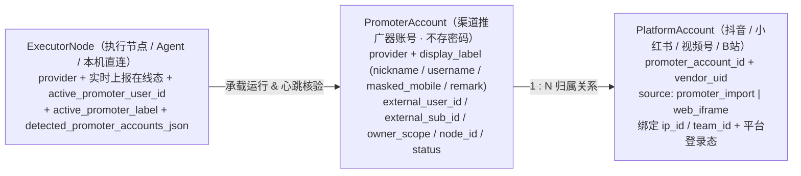
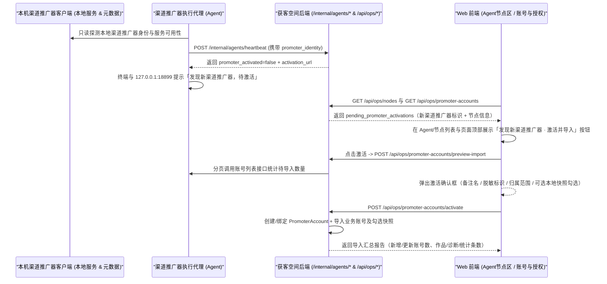

# 渠道推广器账号管理、Agent 激活与全量导入设计方案

> **核心定位**：产品与系统层统一抽象为 **渠道推广器（Channel Promoter）**。全系统（Web 前端、Agent 终端与本机状态页、后端面向用户的状态与报错提示、帮助文档）均不出现任何具体第三方软件品牌名称；底层通过可插拔驱动 `provider`（首期默认内置 `vcat` 驱动）适配具体桌面客户端的 MCP 协议与本机只读元数据目录。

## 1. 背景、痛点、品牌去名化与实测依据

### 1.1 当前「账号与授权」存在的实际缺口

结合当前代码实现（`backend/app/db.py`、`backend/app/operations/service.py`、`frontend/src/pages/ops/OpsAccounts.tsx`、`executor/vcat_agent.py`），现有体系在接入渠道推广器桌面端时存在以下 3 个结构性缺口：

1. **缺少接入即全量导入能力**
   - `GET /api/ops/accounts` 仅查询本地数据库 `platform_accounts` 表；用户在渠道推广器桌面端内直接扫码或导入的存量业务账号，在获客空间前端无法自动看到。
   - 必须人工点击「同步节点账号」才能拉取，且当前 `sync_accounts` 硬编码 `page=1, pageSize=100` 单页请求，超过 100 个业务账号会被截断。
2. **缺少「渠道推广器账号 ↔ 平台业务账号」归属模型**
   - 现有 `platform_accounts` 唯一键为 `(node_id, vendor_uid)`，仅把业务账号挂在物理执行节点（`ExecutorNode`）上，没有记录渠道推广器自身账号实体。
   - 实测同一台电脑的桌面客户端允许切换登录多个渠道推广器账号（数据按账号 ID 隔离在本地子目录）。当客户端切换渠道推广器账号后，原有 `sync_accounts` 的全量比对逻辑会将上一个渠道推广器名下的抖音/小红书/视频号账号误判为「已在渠道推广器移除」，直接将 `active` 置为 `False` 并清空 `ip_id` 与 `team_id`。
3. **缺少节点实时连通态联动与未绑定账号可见性**
   - 前端列表仅展示上次同步保存的 `login_status` 快照，未结合 Agent / 本机直连节点的在线状态、服务就绪态及当前激活的渠道推广器账号做实时状态联动与视觉区分。
   - `_can_access_account` 目前对非管理员用户隐藏 `ip_id` 为空且非本人 `client_local` 节点的账号，导致从团队共享渠道推广器导入的未绑定 IP 存量账号只有管理员可见，团队长无法认领绑定。

### 1.2 全局品牌去名化与文案统一规范

全系统所有面向用户、运维与操作者的文案必须统一使用中立概念 **「渠道推广器」**，彻底移除具体第三方软件品牌词，具体覆盖范围与术语约定如下：

1. **存量与新增全量替换范围**
   - **前端（`frontend/src/`）**：`pages/ops/OpsAccounts.tsx`、`pages/ops/OpsChallenges.tsx`、`pages/ops/OpsTasks.tsx`、`pages/ops/OpsPosts.tsx`、`pages/ops/OpsMonitors.tsx`、`pages/SettingsPage.tsx`、`pages/Help.tsx`、`components/ui.tsx`。
   - **后端面向用户的提示与状态文案**：`backend/app/operations/service.py`、`backend/app/operations/transport.py`、`backend/app/operations/agent_routes.py`。
   - **执行代理与本机状态页**：`executor/vcat_agent.py`、`executor/vcat_agent.env.example`。
2. **标准产品术语对照**
   - 统一使用：**渠道推广器**、**渠道推广器账号**、**所属渠道推广器**、**添加渠道推广器账号**、**渠道推广器导入**、**本机渠道推广器代理**、**服务器直连渠道推广器**、**渠道推广器已切号**、**已在渠道推广器移除** / **从渠道推广器移除**、退化默认标识 `渠道推广器 #<external_user_id>`。
3. **验收红线**
   - 前端源码（`frontend/src/`）以及后端 API / Agent 面向用户返回的提示消息与状态文案中，**严禁残留具体第三方软件名称**；仅在底层驱动适配器（如 `provider="vcat"` 内部探测路径/MCP 工具名映射与环境变量兼容层）保留协议级兼容。

### 1.3 可读标识优先原则与首期驱动（`provider="vcat"`）实测结论

- **核心识别原则**：展示与辨识渠道推广器账号时，**必须优先提供可供人工识别的可读标识（用户名/昵称、或中间 4 位脱敏后的手机号），而非纯数字 ID**；`external_user_id` 仅作为底层唯一关联键与防切号校验键，在界面上退居次级灰色标注。
- **MCP 工具边界**：首期内置驱动（`provider="vcat"`）对接的 119 个 MCP 工具全部面向媒体平台业务账号、作品、统计、评论、私信、店铺与监控，**没有**返回渠道推广器自身登录账号身份的只读工具。
- **首期驱动（`provider="vcat"`）本机只读元数据目录**：macOS 位于 `~/.vcat/`、Windows 位于 `%USERPROFILE%\.vcat/`（支持启动参数或环境变量覆盖），包含稳定且无需密码即可读取的本地元信息：
  - `local.config`：记录 `mcp-setting.userId`（当前启用本地服务绑定的渠道推广器主账号 ID，如示例 `280196`）、`Login_default_id`（当前默认登录的账号 ID）、`mcp-setting.enabled`、`mcp-setting.port`、`mcp-setting.writeModules`、`mcp-setting.tokenTail`。
  - `<userId>/vcat.db` 的 `user` 表：
    - `nickname`：实际存放渠道推广器用户名/昵称（如本机实测可直接读取到 `🦔sonic`、`阿莫`），作为首选可读标识；
    - `name`：部分账号/子账号可能存有登录名或用户名，作为补充可读标识；
    - `sub_id`（子账号 ID）、`avatar`、`lastLogin`、`user_id`；
    - **手机号处理实测与脱敏规范**：实测当前驱动本地库 `user.bind_mobile` 仅为 1 位整数布尔标志位（`1`/`0`，表示是否已绑定手机），并非明文手机号；若后续版本或部分账号在 `name` / `phone` / `mobile` 等可读字段中出现手机号文本，探测端须在**本机内存即时脱敏中间 4 位**（如 `138****5678`），仅上报并存储脱敏值，严禁存储或传输完整明文手机号。
  - 扫描 `<data_home>/*/vcat.db` 即可枚举本机曾登录过的渠道推广器账号及其用户名；未来接入其他渠道推广器软件时，只需新增对应 `provider` 驱动并返回相同标准的 `promoter_identity` 结构即可。
- **主标识展示优先级（`display_label`）**：前端、Agent 终端及本机状态页统一采用以下优先级生成主标识：
  1. 运营人员设置的自定义别名 `remark`（若有，副标题仍保留原始渠道推广器用户名）；
  2. 渠道推广器用户名 `nickname`（如 `🦔sonic`、`阿莫`）；
  3. 账号登录名 `name` 或脱敏手机号 `masked_mobile`（如 `138****5678`；当与 `nickname` 同时存在时可拼装展示为 `🦔sonic（138****5678）`）；
  4. 仅当上述可读标识均为空时，才退化展示 `渠道推广器 #<external_user_id>`，并在激活弹窗中引导填写易辨识的备注名或脱敏手机号标识；`external_user_id` 在所有界面均只作为次级灰色辅助信息展示。
- **严格安全边界**：
  - 探测逻辑仅以只读方式读取上述非敏感标识与展示字段；
  - **严禁读取** `token`、`tokenEnc`、`openid`、Cookie 或任何登录密码，亦严禁外传完整明文手机号；
  - 系统不存储、不管理渠道推广器密码；若在纯远程或容器环境中无法访问本地数据目录，则降级为「手工登记识别名称/备注」兜底完成激活。

---

## 2. 三层对象关系与中立数据模型设计（`backend/app/db.py`）

将原本混淆的“执行机器/通道”与“渠道推广器账号”拆清，形成 **执行节点（`ExecutorNode`） → 渠道推广器账号（`PromoterAccount`） → 平台业务账号（`PlatformAccount`）** 三层中立结构：



遵循 `backend/app/db.py` 现有建表与 `PRAGMA table_info` + `ALTER TABLE` 增量迁移模式，涉及以下 3 处模型调整：

### 2.1 新增表 `promoter_accounts`（ORM 类 `PromoterAccount`）

| 字段名 | 类型与约束 | 说明 |
|---|---|---|
| `id` | `String` PK (`uid`) | 渠道推广器账号在获客空间的内部唯一 ID |
| `provider` | `String`, default `'vcat'`, index | 渠道推广器驱动标识（首期默认 `'vcat'`，支持后续扩展其他推广器） |
| `external_user_id` | `String`, nullable, index | 渠道推广器底层主账号 ID（如 `280196`）；本地探测时作为唯一关联键，手工兜底模式允许为空 |
| `external_sub_id` | `String`, nullable | 子账号 ID（主账号登录时为 `NULL`） |
| `nickname` | `String` | 渠道推广器展示用户名/昵称（如 `sonic`、`阿莫`） |
| `username` | `String`, nullable | 渠道推广器登录名/账号名（来自 `user.name`，可空） |
| `masked_mobile` | `String`, nullable | 脱敏手机号（如 `138****5678`，可空；**仅存中间 4 位脱敏值，严禁存明文**） |
| `remark` | `String`, default `""` | 运营人员自定义别名/备注（优先用于 `display_label` 展示） |
| `avatar` | `Text`, nullable | 渠道推广器账号头像 URL |
| `node_id` | `String`, index | 当前承载该渠道推广器账号的 `ExecutorNode.id` |
| `owner_scope` | `String`, default `'team_shared'` | `team_shared`（团队共享） \| `personal`（个人本机） |
| `owner_user_id` | `String`, nullable, index | `personal` 归属人 ID；共享账号可为空 |
| `identity_source` | `String`, default `'local_probe'` | `local_probe`（本地目录探测） \| `manual_fallback`（远程手工命名兜底） |
| `capabilities_json` | `JSON`, default `{}` | 记录客户端写模块开启概况（不含任何密钥） |
| `status` | `String`, default `'active'` | `active` \| `disabled` |
| `activated_by` | `String`, nullable | 激活操作人 `User.id` |
| `activated_at` | `String`, nullable | 首次激活时间（UTC ISO） |
| `last_seen_at` | `String`, nullable | 最近一次在节点心跳中被探测到在线的时间 |
| `last_synced_at` | `String`, nullable | 最近一次完整同步名下业务账号的时间 |
| `created_at` / `updated_at` | `String` | 标准审计时间戳 |

> 唯一性约束与展示规范：当 `external_user_id` 非空时，按 `(provider, external_user_id, COALESCE(external_sub_id, ''))` 作为逻辑唯一标识，确保同一渠道推广器账号在多台电脑或不同节点切换登录时不会被重复建档；后端接口统一计算并返回 `display_label`（按 `remark` → `nickname` → `username` / `masked_mobile` → `渠道推广器 #<external_user_id>` 优先级生成）。

### 2.2 扩展表 `executor_nodes`

通过增量列迁移新增以下字段，记录节点驱动类型及当前激活登录的渠道推广器可读标识与底层 ID 快照：

| 字段名 | 类型与默认值 | 说明 |
|---|---|---|
| `provider` | `TEXT` (default `'vcat'`) | 节点所连接的渠道推广器驱动类型 |
| `active_promoter_user_id` | `TEXT` (nullable) | 节点最近一次心跳/探测上报的当前登录渠道推广器主账号 ID |
| `active_promoter_sub_id` | `TEXT` (nullable) | 当前登录渠道推广器子账号 ID |
| `active_promoter_label` | `TEXT` (nullable) | 当前登录渠道推广器可读标识（优先展示用户名及可选脱敏手机号） |
| `detected_promoter_accounts_json` | `JSON` (default `[]`) | 该节点本机探测发现的全部渠道推广器账号概要列表（含 `nickname`、`username`、`masked_mobile`、`display_label` 及当前激活标记） |

### 2.3 扩展表 `platform_accounts`

通过增量列迁移新增以下字段，并调整唯一键与同步语义：

| 字段名 | 类型与默认值 | 说明 |
|---|---|---|
| `promoter_account_id` | `TEXT` (nullable, index) | 所属 `promoter_accounts.id` |
| `source` | `TEXT` (default `'promoter_import'`) | `promoter_import`（渠道推广器导入） \| `web_iframe`（前端扫码新增） |
| `group_name` | `TEXT` (nullable) | 渠道推广器内分组名称快照 |
| `tags_json` | `JSON` (default `[]`) | 渠道推广器内标签名称快照 |
| `remark` | `TEXT` (default `''`) | 业务账号备注快照 |
| `fans_total` | `INTEGER` (nullable) | 来自账号列表接口的粉丝总数快照 |

**同步对齐与换机迁移规则**：
1. **同步去重范围隔离**：同步平台业务账号时，**仅核对同一 `promoter_account_id` 名下的 `PlatformAccount`**；当同一台电脑切换登录另一个渠道推广器账号时，原 `PromoterAccount` 下的业务账号保持 `active=True` 与原有 `ip_id/team_id` 绑定不变，绝不误标移除。
2. **跨节点平滑迁移**：同一渠道推广器账号（相同 `provider + external_user_id + external_sub_id`）从节点 A 换到节点 B 登录并激活/识别时，复用原有 `PromoterAccount` 记录，将 `PromoterAccount.node_id` 及名下所有 `PlatformAccount.node_id` 原子更新为新节点 ID，已有 IP 绑定、历史作品与发布排期无缝保留。
3. **历史数据兼容**：对于升级前已存在的 `promoter_account_id IS NULL` 历史账号，首次对其所属节点激活或同步 `PromoterAccount` 时，若 `vendor_uid` 匹配则自动回填 `promoter_account_id`。

---

## 3. 本机与 Agent 的渠道推广器账号探测与展示（`executor/vcat_agent.py` + `backend/app/operations/`）

### 3.1 共用只读探测模块 `detect_local_promoter_state`

在共享模块中实现 `detect_local_promoter_state(provider: str = "vcat", data_home: Path | None = None)`，供 `executor/vcat_agent.py`（`server_relay` / `client_local` 模式）与后端（`server_direct` 同机直连模式）统一调用：

1. **驱动与目录定位**：根据 `provider` 选择对应只读适配器；首期 `provider="vcat"` 优先读取传入的 `data_home`（或环境变量 `PROMOTER_DATA_HOME` / 兼容 `VCAT_HOME`），默认定位 `Path.home() / ".vcat"`（兼容 macOS 与 Windows）。
2. **只读解析与本机脱敏**：
   - 读取配置文件提取当前活跃账号 ID 与服务状态（端口号、启用态、写模块列表）。
   - 以 SQLite 只读 URI（`file:<path>?mode=ro`，`timeout=1.0`）读取 `user_id, sub_id, name, nickname, avatar, lastLogin`（以及仅在本机内存检查字段内是否含手机号文本用于中间 4 位即时脱敏；**绝不查询或外传 `token`、`openid`、明文手机号与密码**）。
   - 本机即按统一优先级生成 `masked_mobile`（若有手机号文本则脱敏为 `前3位 + **** + 后4位`）与 `display_label`（如 `sonic` 或 `sonic（138****5678）`），确保无论前端、Agent 终端还是本机状态页都直接展示可读标识而非纯数字 ID。
3. **标准输出结构（`promoter_identity`）**：

```json
{
  "detected": true,
  "provider": "vcat",
  "active_account": {
    "external_user_id": "280196",
    "external_sub_id": null,
    "nickname": "sonic",
    "username": null,
    "masked_mobile": "138****5678",
    "display_label": "sonic（138****5678）",
    "avatar": "",
    "last_login": "2026-11-26 05:50:56",
    "service_enabled": true,
    "service_port": 3199,
    "write_modules": {"manage": true, "publish": true, "stats": true}
  },
  "known_accounts": [
    {
      "external_user_id": "280196",
      "external_sub_id": null,
      "nickname": "sonic",
      "username": null,
      "masked_mobile": "138****5678",
      "display_label": "sonic（138****5678）",
      "is_active": true
    },
    {
      "external_user_id": "363878",
      "external_sub_id": null,
      "nickname": "阿莫",
      "username": null,
      "masked_mobile": null,
      "display_label": "阿莫",
      "is_active": false
    }
  ]
}
```

4. **降级容错**：若目录不存在、文件损坏或数据库锁冲突，静默返回 `{"detected": false, "provider": provider, "active_account": None, "known_accounts": []}`，绝不影响 Agent 心跳与指令轮询。

### 3.2 Agent 上报协议与本机展示升级

- **心跳与注册上报**：
  - `POST /internal/agents/register` 与 `POST /internal/agents/heartbeat` 请求体新增可选字段 `promoter_identity: dict | None`（保留内部字段兼容）。
  - 后端在收到上报后更新 `ExecutorNode.provider`、`active_promoter_user_id`、`active_promoter_sub_id`、`active_promoter_label`（写入 `display_label`）、`detected_promoter_accounts_json`，并查询该 `(provider, external_user_id, external_sub_id)` 是否存在已激活的 `PromoterAccount`：
    - 若已激活：更新 `PromoterAccount.last_seen_at`（若当前已迁移到本节点则同步 `node_id`），心跳响应返回：
      `{"ok": true, "promoter_activated": true, "promoter_account_id": "...", "promoter_account_label": "<display_label>", "activation_url": null}`；
    - 若未激活：心跳响应返回：
      `{"ok": true, "promoter_activated": false, "promoter_account_id": null, "promoter_account_label": "<display_label>", "activation_url": "/#ops-accounts?activate_node=<node_id>"}`。
- **Agent 终端与本机状态页展示**：
  - 每次启动或探测到渠道推广器账号切换/未激活状态变化时，终端打印清晰提示：统一称呼 **「渠道推广器」**，优先突出可读账号标识 `display_label`（如 `sonic（138****5678）`），`external_user_id` 仅置括号次级展示，并说明「已激活」或「未在获客空间激活，请前往 Web 节点页面点击激活并导入」。
  - 本机 HTTP 探针（`127.0.0.1:18899`）：
    - `GET /health`（供前端只读状态条跨域读取）：在原有字段外补充 `promoter_provider`、`promoter_display_label`、`promoter_nickname`、`promoter_masked_mobile`、`promoter_external_user_id`、`promoter_activated`、`promoter_account_id`、`known_promoter_count`（仍不含任何 Token/凭据/明文手机号/业务账号隐私）。
    - `GET /`（本机浏览器直接访问的轻量状态页）：页面标题与文案统一展示 **「本机渠道推广器代理状态」**，展示代理在线状态、渠道推广器服务就绪态、当前识别的渠道推广器可读用户名/脱敏手机号及本机发现账号列表（ID 仅作次级辅助标注）；若 `promoter_activated == false`，展示高亮提示和「前往获客空间激活并导入」跳转链接（指向获客空间 Web 页面完成登录态鉴权与导入，避免在无鉴权的本地端口暴露写操作）。

---

## 4. 「新渠道推广器发现 → 激活并导入」全链路与导入范围

### 4.1 激活与导入交互流程



### 4.2 激活时的数据导入清单（必导 / 可选顺带导 / 不导入）

#### 1. 必导内容（激活核心）

| 内容 | 数据来源 | 目标表 | 导入策略 |
|---|---|---|---|
| **渠道推广器自身账号元数据** | `promoter_identity.active_account`（兜底支持手工名称） | `promoter_accounts` | 记录 `provider`、`nickname`、`username`、`masked_mobile`（脱敏）、`remark`、`external_user_id`、`external_sub_id`、`owner_scope` 与关联 `node_id`；激活弹窗默认预填可读用户名并允许补充别名或脱敏手机标识 |
| **全量平台业务账号** | 分页循环调用 `vcat_list_accounts(page=1..N, pageSize=100)` 直到覆盖 `total` | `platform_accounts` | 无论前端扫码添加还是在渠道推广器客户端直接添加，全部入库；写入 `promoter_account_id`、`source='promoter_import'`、`group_name`、`tags_json`、`remark`、`fans_total`、`login_status` |

#### 2. 默认勾选、可取消的只读本地缓存快照（零平台请求、无风控、单项失败不阻塞主激活）

| 内容 | 数据来源 | 目标表 | 纳入理由与保护策略 |
|---|---|---|---|
| **已有历史作品快照** | 分页调用只读作品列表接口（仅读渠道推广器本地作品缓存，**不调用**触发平台抓取的同步动作） | `published_posts` + `metric_snapshots` | 「运营 → 作品与数据」直接读本地表；导入后页面立即可见历史作品及播放/点赞基线，统一执行 `< 0` 转 `NULL` 清洗 |
| **视频号已有诊断状态** | 单次调用只读诊断结果列表接口 | 回填 `platform_accounts` (`is_verified`, `last_verified_at`, `verify_summary_json`) | 批量同步渠道推广器里已有的视频号诊断结果，避免刚导入的视频号全部误显「未诊断」 |
| **账号统计基线快照** | 由账号列表 `fansTotal` 写入当日快照；账号数 ≤ 20 时顺带调只读统计接口补赞/藏/分日基线 | `metric_snapshots` | 让「作品与数据 / 数据复盘」在激活后立刻有初始粉丝与互动基线（不触发平台实时刷新） |

#### 3. 明确不导入的内容及原因

| 内容 | 不导入原因 |
|---|---|
| **评论、私信、监控任务、流速报告、异常作品** | 获客空间对应页面已在打开时实时经推广器代理查询；业务账号与 `promoter_account_id` 关系导入后即可直接使用，无需重复落库 |
| **渠道推广器内置草稿 & 历史发布任务** | 获客空间的发布台账强绑定内部 `schedule_id`、`draft_id` 与审批快照，导入未走审批的客户端任务会污染台账；远端草稿可通过 `GET /api/ops/drafts?sync_remote=true` 按需查看 |
| **代理服务器、上号链接、Cookie / 分享码** | 属于推广器客户端底层运维或高敏凭据，平台不接管也不存储 |
| **店铺与订单** | 属于后续 P3 扩展模块，当前平台尚无对应模型与页面 |

### 4.3 手动添加渠道推广器账号（含同机直连与远程兜底）

除 Agent 心跳自动发现外，在「运营 → 账号与授权」提供 **「添加渠道推广器账号」** 按钮：
- 可选择已有节点（`server_direct` 同机直连、`server_relay` 托管执行机、`client_local` 本机代理）；
- 若选 `server_direct`，后端先执行一次本机探测（`detect_local_promoter_state`）+ 本地服务连通性检查，自动带出当前渠道推广器账号预览并走同一套激活导入流程；
- 若所选节点无法读取本地元数据目录（`detected=false`），允许用户输入自定义识别名完成 `manual_fallback` 兜底激活并导入该节点当前的全部业务账号。

---

## 5. 实时状态计算与前端差异化展示设计

### 5.1 两层实时状态定义（后端统一计算返回）

#### A. 渠道推广器账号实时状态（`runtime_status`）

| 状态值 | 标签 | 判定条件 | 展示与交互含义 |
|---|---|---|---|
| `online_active` | 🟢 在线已激活 | 节点在线（心跳 `< 90s` 或直连探测正常）+ 推广器服务就绪 + 节点 `active_promoter_user_id` 匹配（或 `manual_fallback` 在线） | 正常高亮；可执行同步、上号、发布与数据刷新 |
| `switched_away` | 🟡 已切号未激活 | 节点在线，但节点当前 `active_promoter_user_id` 与该渠道推广器账号不匹配 | 黄色警示条提示「当前客户端登录为 XXX，请切回此账号后再执行操作」 |
| `service_error` | 🔴 渠道推广器服务异常 | Agent 在线，但本地推广器服务不可用或未登录会员 | 红色异常提示，引导检查客户端本地服务开关与会员态 |
| `offline` | ⚪ 节点离线 | Agent 心跳超时（`> 90s`）、直连失败或节点已吊销 | 灰态展示最后在线时间 |

#### B. 业务账号综合可用状态（`availability_status`）

| 状态值 | 标签 | 判定条件 | 表格行与按钮差异化展示 |
|---|---|---|---|
| `ready` | 🟢 就绪可用 | 所属渠道推广器 `online_active` + 平台 `login_status == "登录有效"` | 正常高亮显示，全部操作按钮可用 |
| `platform_expired` | 🟠 平台需重登 | 所属渠道推广器 `online_active` + 平台登录失效/未知 | 橙色徽标提示，高亮「重登/扫码」引导 |
| `promoter_switched` | 🟡 所属推广器已切号 | 所属渠道推广器处于 `switched_away` | 整行视觉弱化 + 「渠道推广器未激活」提示，禁用即时执行动作（发布/刷新/同步/诊断），保留「绑定IP」等纯平台库操作 |
| `node_offline` | ⚪ 离线缓存 | 所属渠道推广器处于 `offline` 或 `service_error` | 整行灰态 + 「离线缓存」标签，仅展示本地缓存数据，禁用即时执行动作 |
| `removed` | ⚫ 已在渠道推广器移除 | `active == False` | 默认隐藏，勾选「显示已移除历史账号」后灰态只读展示 |

### 5.2 前端页面落点

1. **「运营 → 账号与授权」（`frontend/src/pages/ops/OpsAccounts.tsx`）**
   - **顶部待激活提示横幅**：当 `pending_promoter_activations` 非空时，在页面最上方醒目提示「检测到节点 XXX 已连接新渠道推广器账号 `<display_label>`（如 `sonic` 或 `阿莫`），尚未导入业务账号」，并提供一键 **「激活并导入」** 按钮；点击后弹窗预填识别到的用户名/脱敏手机号（若有），并支持补充自定义备注名与脱敏手机标识以便区分。
   - **上半区「渠道推广器账号管理」卡片**：展示所有已激活的 `PromoterAccount`（主标展示 `display_label`：自定义别名 / 渠道推广器用户名 / 脱敏手机号，`external_user_id` 仅作次级灰色辅助标注；另含关联节点与模式、实时状态徽标 `runtime_status`、名下业务账号数量、最近同步时间），支持：
     - 点击某渠道推广器卡片/行直接过滤下方业务账号列表；
     - 操作：「同步业务账号」「编辑备注/归属」「停用/启用」；
     - 卡片右上角提供「添加渠道推广器账号」入口。
   - **中间「已配对执行节点（Agent）」卡片**：新增「当前渠道推广器账号（主显用户名/脱敏手机，次显 ID）」与「激活状态」列；对于连上了新渠道推广器（`promoter_activated == false`）的节点，行内直接显示黄色提示标签与 **「激活并导入」** 按钮。
   - **下半区「平台业务账号」表格**：
     - 新增列：**「所属渠道推广器」**（展示 `display_label`）、**「接入来源」**（`渠道推广器导入` / `前端扫码`）、**「综合可用态」**；
     - 顶部筛选器：按渠道推广器账号筛选、按综合可用态筛选、只看「未绑定 IP 待认领账号」；
     - 行样式与按钮控制：针对 `promoter_switched` 和 `node_offline` 行应用明显的视觉弱化样式（如 `.row-dimmed`）与原因 tooltip，并禁用需要实时连接渠道推广器的操作按钮。
2. **「系统设置 → 发布执行器」（`frontend/src/pages/SettingsPage.tsx`）**
   - 配置表单、模式说明与节点列表全部改称「渠道推广器」（如「渠道推广器服务地址」「渠道推广器访问令牌」「配对本机渠道推广器代理」）；
   - 节点管理表格同步增加「当前连接的渠道推广器账号」列（同样优先展示可读用户名/脱敏手机号），并针对未激活节点直接展示 **「激活并导入」** 按钮，使管理员在节点配置页与运营页都能第一时间发现并激活新渠道推广器。

### 5.3 服务端执行防串号保护（`backend/app/operations/service.py`）

在 `_execute_mcp`（或各业务方法针对 `account_id` 解析目标节点时）加入切号核验：
- 若操作对象绑定了 `PromoterAccount`，且其关联的在线节点当前上报的 `active_promoter_user_id` 与该 `PromoterAccount.external_user_id` 不一致（即用户把客户端切换成了另一个渠道推广器账号）：
  - **直接拦截**并返回明确中文错误（HTTP `409`）：`「当前节点的渠道推广器已切换为另一账号（<当前 display_label>），请先在客户端切回（<目标 display_label>）后再执行该操作」`；
  - 彻底防止把账号 A 的发布任务、草稿或删除指令错发到账号 B 登录的渠道推广器实例中。

---

## 6. 多角色权限与可见口径

| 角色 | 渠道推广器账号与 Agent 节点权限 | 平台业务账号可见与操作范围 |
|---|---|---|
| **管理员 (`admin`)** | 查看与管理全部 `team_shared` / `personal` 渠道推广器账号及节点；可激活任意节点发现的新渠道推广器 | 可见所有渠道推广器下的全部业务账号（含未绑定 IP 账号）；可绑定/解绑任意 IP 与管理去重 |
| **团队长 (`leader`)** | 可见 `team_shared` 渠道推广器及本人的 `personal` 渠道推广器；可激活 `team_shared` 与本人 `client_local` 节点 | 可见已授权给本团队 IP 的账号 **+ 团队共享渠道推广器导入的未绑定 IP 存量账号**，并可将未绑定账号认领绑定到本团队授权 IP；可见本人 `client_local` 渠道推广器账号 |
| **队员 (`member`)** | 仅见本人配对的 `client_local` 渠道推广器与节点；可激活与管理自己的本机渠道推广器 | 仅见已绑定到自己授权 IP 的业务账号，以及自己 `client_local` 渠道推广器名下的账号；不可查看或操作共享渠道推广器中未绑定 IP 的账号 |

---

## 7. 后端 API 契约设计（`/api/ops/*` 与 `/internal/agents/*`）

### 7.1 新增与扩展 `/api/ops/*` 接口

| 方法与路径 | 用途 | 核心入参 / 出参要点 |
|---|---|---|
| `GET /api/ops/promoter-accounts` | 获取可见渠道推广器账号列表与待激活列表 | 返回 `{"items": [...], "pending_activations": [...]}`；每项含 `provider`、`display_label`、`nickname`、`username`、`masked_mobile`、`external_user_id`、`runtime_status`、`runtime_reason`、`account_count`、`node_name`、`node_scope` |
| `POST /api/ops/promoter-accounts/preview-import` | 激活前预拉取待导入统计 | 入参 `{"node_id": "..."}`；探测渠道推广器身份（含 `display_label`、`nickname`、`username`、`masked_mobile`）并分页预统计 `account_count`（按平台汇总）、`post_count`、`verify_count` |
| `POST /api/ops/promoter-accounts/activate` | 激活新渠道推广器并执行导入 | 入参 `node_id`、`remark?`、`masked_mobile?`、`owner_scope?`、`manual_name?`、`import_posts=true`、`import_verify=true`、`import_stats=true`；返回 `promoter_account`（含 `display_label`）与 `import_summary`（导入账号数、作品数、诊断数、统计数及单项非阻塞警告） |
| `PATCH /api/ops/promoter-accounts/{promoter_account_id}` | 修改备注、归属范围或启停 | 校验 `admin` 或节点所有者权限；支持更新 `remark`、`masked_mobile`、`owner_scope`、`status` |
| `POST /api/ops/promoter-accounts/{promoter_account_id}/sync` | 定向同步该渠道推广器全部业务账号 | 校验节点在线且未切号，分页调用账号列表接口，仅更新该 `promoter_account_id` 名下账号 |
| `GET /api/ops/nodes`（扩展） | 返回节点列表与待激活清单 | 每个节点增加 `provider`、`active_promoter_user_id`、`active_promoter_label`、`promoter_activated`、`promoter_account_id`、`detected_promoter_accounts`；顶层附加 `pending_promoter_activations` |
| `GET /api/ops/accounts`（扩展） | 获取业务账号列表 | 新增查询参数 `promoter_account_id`、`availability_status`、`unbound_only`；每行返回 `promoter_account_id`、`promoter_account_label`（优先 `display_label`）、`promoter_provider`、`promoter_external_user_id`、`promoter_username`、`promoter_masked_mobile`、`source`、`group_name`、`tags`、`remark`、`fans_total`、`availability_status`、`availability_reason` |

### 7.2 扩展 `/internal/agents/*` 接口

- `POST /internal/agents/register`：接收可选 `promoter_identity`，立即落库节点上的 `provider`、`active_promoter_*` 与 `detected_promoter_accounts_json`，并在响应中返回 `promoter_activated` 与 `activation_url`。
- `POST /internal/agents/heartbeat`：接收可选 `promoter_identity`，实时刷新节点激活账号信息与对应 `PromoterAccount.last_seen_at`，并在响应中返回 `promoter_activated`、`promoter_account_id`、`promoter_account_label`、`activation_url`。

---

## 8. 实施拆分、验证方案与待确认项

### 8.1 分阶段实施计划

1. **阶段 1：数据层与增量迁移（`backend/app/db.py`）**
   - 新增 `PromoterAccount` ORM 模型（表 `promoter_accounts`）；扩展 `ExecutorNode`、`PlatformAccount` 列及 SQLite `ALTER TABLE` 启动自动迁移逻辑。
2. **阶段 2：共享探测模块与 Agent 升级（`backend/app/operations/promoter_probe.py`、`executor/vcat_agent.py`、`backend/app/operations/agent_routes.py`）**
   - 实现跨平台只读渠道推广器探测函数（含首期 `vcat` 驱动与本机即时脱敏）；升级 Agent 心跳/注册上报、终端提示与 `127.0.0.1:18899` 只读状态页和 `/health` 返回字段，全面去名化为「渠道推广器」。
3. **阶段 3：业务服务、全局文案去名化与 API 路由（`backend/app/operations/service.py`、`routes.py`、`transport.py`）**
   - 实现 `PromoterAccount` 激活导入闭环（分页全量账号 + 可选作品/诊断/统计只读快照）、`runtime_status` / `availability_status` 统一计算、切号误操作拦截、跨节点迁移、权限口径升级，以及全部面向用户的后端状态与报错文案去名化。
4. **阶段 4：前端 UI 去名化改造与自动化测试（`OpsAccounts.tsx`、`OpsChallenges.tsx`、`OpsTasks.tsx`、`OpsPosts.tsx`、`OpsMonitors.tsx`、`SettingsPage.tsx`、`Help.tsx`、`ui.tsx`、`styles.css`、前后端测试）**
   - 完成顶部待激活横幅、渠道推广器账号管理区、节点激活列与按钮、业务账号来源/所属渠道推广器/状态差异化展示与筛选；将全前端页面中残留的第三方软件品牌词统一替换为「渠道推广器」；补充前后端自动化测试。

### 8.2 自动化验证覆盖计划

- **后端单元测试（`backend/tests/test_operations.py`）**：
  - 构造模拟本地数据目录（含配置与多账号数据库），验证只读探测优先输出可读用户名与脱敏手机号、不泄露敏感字段、单次激活完成分页（`>100` 条）业务账号全量导入及作品（含 `-1` 清洗）/诊断/统计可选导入；
  - 验证同一电脑切号登录另一渠道推广器账号时：不会误删旧账号名下业务账号、实时计算状态切换为 `switched_away` / `promoter_switched`、发起操作被正确拦截并返回提示；
  - 验证同一 `external_user_id` 换节点接入时平滑迁移且保留 IP 绑定；
  - 验证 `admin` / `leader` / `member` 三角色对共享未绑定账号与个人本机账号的权限边界；
  - 断言面向用户的接口报错与状态文案均使用「渠道推广器」，不含具体第三方软件名称。
- **前端 E2E 测试与文案红线校验（`frontend/tests/operations.spec.ts`）**：
  - Mock 新 Agent 上报未激活渠道推广器，验证「账号与授权」与「系统设置 → 发布执行器」出现提示与「激活并导入」按钮，且界面以可读用户名/脱敏手机号为主标识；
  - 验证点击激活弹窗预览、勾选导入项、提交后渠道推广器卡片与全部导入账号立即展示，且离线/切号状态在列表中有清晰视觉与禁用区分；
  - 静态与页面渲染扫描验证：`frontend/src/` 页面与用户可见文本中不出现具体第三方软件品牌名称，统一展示为「渠道推广器」。

### 8.3 请在审阅中重点确认的 3 个决策点

1. **入口布局**：将「渠道推广器账号管理（含“添加/激活渠道推广器”向导）」直接集成在 **「运营 → 账号与授权」** 上半区，同时在 **「系统设置 → 发布执行器」** 节点列表同步暴露「当前渠道推广器账号 + 激活并导入」入口，是否满足你的使用习惯？（还是希望在「运营」下再单独拆一个一级菜单？）
2. **未绑定 IP 存量账号的认领权限**：从团队共享渠道推广器导入、尚未绑定 IP 的存量业务账号，**管理员和团队长都可见并可绑定到本团队 IP**，普通队员仅见自己有权限的 IP 账号及个人本机渠道推广器账号，是否符合团队协作规则？
3. **激活时默认顺带导入的只读快照项**：除必导的「渠道推广器账号 + 全部业务账号」外，在激活弹窗中**默认勾选**「已有历史作品快照（只读本地缓存）」「视频号已有诊断结果」「账号统计基线」（用户可按需取消勾选），是否认可？
